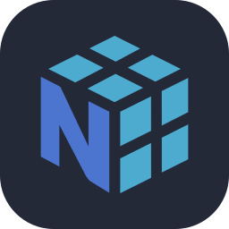
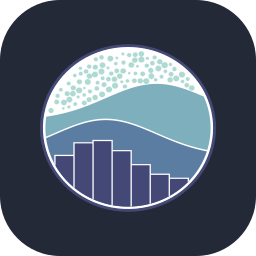
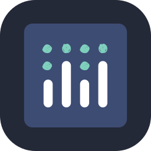
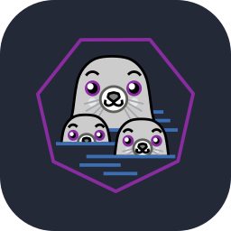

<!--Presentación de Git-->

    <h1>console.log("Hello World!!")</h1>
    

<h2 align="center">Acerca de mí</h2>

    
Hola a todos, soy Jorge, Ingeniero de Datos especializado en inteligencia artificial y apasionado de la tecnología.
    Me fascina explorar el mundo de la ciencia de datos, el machine learning y el desarrollo de software.
    Además de construir proyectos de todo tipo, me apasiona aprender y compartir lo que sé.

<h2 align="center">Lenguajes y Herramientas</h2>

<h3 align="center">Datos, Machine Learning e IA</h3>

  
  
  
  
  
  
  
  

<h3 align="center">Bases de datos</h3>

  
  

<h3 align="center">Backend e ingeniería de datos</h3>

  
  
  

<h3 align="center">Lenguajes y desarrollo web</h3>

  

    
¡No dudes en contactarme!  Estaré encantado de ayudarte en lo que necesites.

    
    

